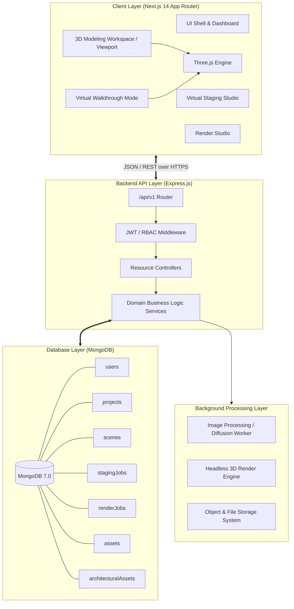

# Archvizon — System Architecture & Technical Specifications

**Version:** 2.0 (Architectural 3D Modeling, Rendering & Virtual Staging Platform)  
**Date:** November 2026  

---

## 1. System Architecture Overview

Archvizon is structured as a decoupled, multi-tier web application consisting of a modern Next.js client-side 3D workspace, a Node.js/Express RESTful backend, a MongoDB document store, and specialized processing pipelines for AI virtual staging and architectural rendering.



---

## 2. Frontend Architecture (Next.js & Three.js)

### 2.1 State & Component Organization
- **Framework:** Next.js 14.2 (App Router) + React 18.
- **Styling:** Tailwind CSS with custom design tokens (`arch-card`, `arch-input`, `arch-button-primary`, `arch-button-secondary`).
- **3D Graphics Engine:** Three.js (`three` `^0.187.0`). Built on pure WebGL rendering with React ref binding for maximum performance, instantaneous response to transformation gizmos, and zero reconciler overhead during high-frequency manipulation (60 FPS).
- **Core Viewport Components:**
  - `Viewport3D`: Initializes WebGLRenderer, PerspectiveCamera, Scene, lighting, and handles window resize.
  - `OrbitControls`: Camera orbit, pan, and zoom clamping.
  - `TransformControls`: Interactive gizmos for Translation (W), Rotation (E), and Scale (R) in World or Local coordinate space.
  - `Raycaster`: Single-click and box selection of 3D meshes with bounding box highlight.
  - `GridHelper` & `AxesHelper`: Visual spatial grounding with millimeter/centimeter/meter snapping.
  - `GLTFExporter`: Client-side binary export of the 3D scene to `.glb` / `.gltf`.

### 2.2 3D Scene Graph Data Structure
The in-memory 3D scene is represented as a normalized JSON tree synchronized with the backend:
```json
{
  "projectId": "6af824fa39f8e91fe036d5d5",
  "version": 1,
  "environment": {
    "backgroundColor": "#0f172a",
    "ambientLight": { "color": "#ffffff", "intensity": 0.6 },
    "directionalLight": { "color": "#ffffff", "intensity": 1.2, "position": [10, 20, 10] },
    "grid": { "visible": true, "size": 30, "divisions": 30, "snap": 0.5 }
  },
  "camera": {
    "position": [8, 6, 8],
    "target": [0, 1, 0],
    "fov": 60
  },
  "objects": [
    {
      "id": "uuid-wall-1",
      "type": "WALL",
      "name": "Exterior Wall North",
      "position": [0, 1.5, -4],
      "rotation": [0, 0, 0],
      "scale": [8, 3, 0.2],
      "geometry": { "type": "BOX", "parameters": { "width": 8, "height": 3, "depth": 0.2 } },
      "material": { "color": "#e2e8f0", "roughness": 0.8, "metalness": 0.1, "texture": "PLASTER_WHITE" },
      "visible": true,
      "locked": false
    }
  ]
}
```

---

## 3. Backend Architecture (Node.js & Express.js)

### 3.1 Modular Request Flow
```
HTTP Request
    |
    v
Express Route (/api/v1/...)
    |
    v
Security Middleware (Helmet, CORS, RateLimit)
    |
    v
Authentication Middleware (JWT Bearer Token verification)
    |
    v
Authorization Middleware (RBAC & Resource Ownership verification)
    |
    v
Input Validation (express-validator)
    |
    v
Controller (Reads input, calls domain service, returns standardized JSON)
    |
    v
Service Layer (Implements business rules, state transitions, job orchestration)
    |
    v
Mongoose Models & MongoDB
```

### 3.2 Response Envelope Standard
All API endpoints follow a consistent JSON envelope:
- **Success:**
  ```json
  {
    "success": true,
    "message": "Resource retrieved successfully",
    "data": {}
  }
  ```
- **Error:**
  ```json
  {
    "success": false,
    "message": "Validation or execution error description",
    "errors": []
  }
  ```

---

## 4. Database Schema Specifications (MongoDB / Mongoose)

### 4.1 Collection Relationships
- `users`: Core account identity and credentials.
- `projects`: Architectural projects owned by a user (`clientId`).
- `scenes`: 3D spatial scenes belonging to a project (`projectId`).
- `stagingJobs`: Asynchronous AI virtual staging tasks with status lifecycle.
- `renderJobs`: Asynchronous architectural rendering tasks with status lifecycle.
- `architecturalAssets`: Catalog of reusable furniture, structural elements, and PBR materials.
- `assets`: Binary asset metadata (source drawings, textures, uploads).

### 4.2 Key Schemas

#### `scenes` Collection
- `projectId`: ObjectId (Ref: Project, indexed)
- `userId`: ObjectId (Ref: User, indexed)
- `name`: String
- `version`: Number
- `environment`: Object (ambientLight, directionalLight, backgroundColor, gridSettings)
- `camera`: Object (position, target, fov)
- `objects`: Array of Object definitions:
  - `id`: String (UUID)
  - `type`: String (`PRIMITIVE`, `WALL`, `FLOOR`, `DOOR`, `WINDOW`, `FURNITURE`, `LIGHT`)
  - `name`: String
  - `position`: `[x, y, z]`
  - `rotation`: `[x, y, z]` (Euler in degrees or radians)
  - `scale`: `[x, y, z]`
  - `geometry`: Object (primitive type, width, height, depth, radius, segments)
  - `material`: Object (color, roughness, metalness, wireframe, textureUrl)
  - `visible`: Boolean
  - `locked`: Boolean
  - `parentId`: String
- `createdAt`, `updatedAt`: Timestamps

#### `stagingJobs` Collection
- `projectId`: ObjectId (Ref: Project, indexed)
- `userId`: ObjectId (Ref: User, indexed)
- `originalImageUrl`: String
- `roomType`: String (`LIVING_ROOM`, `BEDROOM`, `KITCHEN`, `DINING_ROOM`, `HOME_OFFICE`, `TERRACE`)
- `designStyle`: String (`MODERN`, `CONTEMPORARY`, `SCANDINAVIAN`, `MINIMALIST`, `INDUSTRIAL`, `LUXURY`, `TRADITIONAL`)
- `preferences`: Object (furnitureDensity, colorPalette, customNotes)
- `status`: String (`PENDING`, `PROCESSING`, `COMPLETED`, `FAILED`, indexed)
- `progress`: Number (0-100)
- `resultImageUrl`: String
- `provider`: String
- `errorDetails`: String
- `createdAt`, `completedAt`: Dates

#### `renderJobs` Collection
- `projectId`: ObjectId (Ref: Project, indexed)
- `sceneId`: ObjectId (Ref: Scene, indexed)
- `userId`: ObjectId (Ref: User, indexed)
- `settings`: Object:
  - `resolution`: String (`FHD`, `4K`, `8K`)
  - `quality`: String (`DRAFT`, `PRODUCTION`, `ULTRA`)
  - `cameraPosition`: `[x, y, z]`
  - `cameraTarget`: `[x, y, z]`
  - `lightingScenario`: String (`DAY`, `DUSK`, `NIGHT`, `STUDIO`)
  - `samples`: Number
- `status`: String (`PENDING`, `PROCESSING`, `COMPLETED`, `FAILED`, indexed)
- `progress`: Number (0-100)
- `outputUrl`: String
- `durationMs`: Number
- `createdAt`, `completedAt`: Dates

---

## 5. Asynchronous Processing Workflows

### 5.1 Virtual Staging Pipeline
1. Client uploads raw photograph of empty space via `POST /api/v1/staging`.
2. Backend creates `StagingJob` in `PENDING` state and queues processing.
3. Provider abstraction selects active service (configured external API or built-in high-precision visual processing engine).
4. Worker generates furnished rendering adhering to selected room type and design style.
5. Result is stored in storage service, `StagingJob` status is updated to `COMPLETED`, and output URL is registered.
6. Client polls `GET /api/v1/staging/:jobId` and displays split-screen comparison slider.

### 5.2 Architectural Rendering Pipeline
1. Client positions camera and configures lighting in 3D viewport or Render Studio.
2. Client submits render request via `POST /api/v1/render`.
3. Backend creates `RenderJob` in `PENDING` state with full scene snapshot.
4. Render worker reads scene geometry, transforms, materials, lights, and executes high-sample raymarching/rendering.
5. Rendered frame is encoded to high-res PNG/JPG, stored, and marked `COMPLETED`.
6. Client retrieves finished render, views in full-screen lightbox, and downloads uncompressed master.

---

## 6. Security & Authorization Architecture

- **Token Security:** Signed JWTs stored in browser `localStorage` or `HttpOnly` cookies, verified on every API request.
- **Resource Isolation:** Ownership checks enforce that users can only inspect, edit, or delete their own projects, scenes, staging jobs, and render results.
- **File Validation:** Multer middleware validates file types, extensions (`.jpg`, `.png`, `.webp`, `.dwg`, `.dxf`, `.pdf`, `.glb`, `.gltf`), and enforces strict file size ceilings.
- **Password Protection:** Passwords hashed with bcrypt (salt rounds = 10). Password hashes never returned in API payloads (`select: false` on Mongoose schema).
