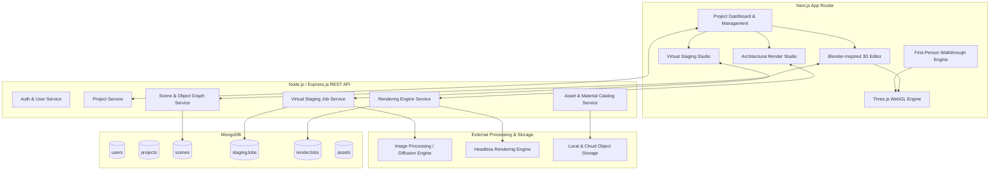

# Archvizon — Master Implementation Plan

**Objective:** Transform Archvizon into a complete, functional, web-based architectural 3D modelling, visualization, rendering, and virtual staging platform inspired by Blender.

---

## 1. Architectural Strategy

The transformation will preserve the working Node/Express backend and Next.js frontend structure while introducing the core 3D spatial engine, scene persistence, parametric architectural generation, interior asset management, AI-driven virtual staging, and architectural rendering pipelines.

---

## 2. Phase-by-Phase Roadmap

### PHASE 1 — Project Restructuring, Foundation, and Authentication
- **Objective:** Establish the foundation, update branding, streamline project management, and extend authentication.
- **Backend Deliverables:**
  1. Add forgot/reset password API endpoints to `authRoutes` and `authService`.
  2. Implement project duplication and project thumbnail update in `projectService`.
  3. Create centralized error handling and request validators for new project parameters.
  4. Ensure all existing 68 tests continue passing without regression.
- **Frontend Deliverables:**
  1. Update landing page (`/`) to present the 3D design, modeling, virtual staging, and rendering capabilities.
  2. Enhance `/login` with forgot password workflow and feedback states.
  3. Redesign Dashboard (`/dashboard`) into a modern 3D Project Workspace with cards showing 3D scene badges, last modified dates, search, filtering, duplication, deletion, and quick-action buttons ("Launch 3D Editor", "Virtual Staging", "Render", "Walkthrough").
  4. Redesign Project Creation (`/projects/new`) to quickly initiate 3D architectural spaces (Studio, Living Room, Villa, Commercial Office, or Empty Canvas).
  5. Refactor `/projects/[id]` to act as the primary project overview and launchpad for the 3D tools.

### PHASE 2 — Core 3D Modelling Engine and Workspace
- **Objective:** Build the central interactive browser-based 3D workspace inspired by Blender.
- **Backend Deliverables:**
  1. Implement `Scene` model (`backend/src/models/Scene.js`) with schema for objects (id, type, name, position, rotation, scale, geometry parameters, material parameters, visibility, lock, hierarchy), camera, lighting, and environment configuration.
  2. Implement `sceneService.js` and `sceneController.js` with endpoints:
     - `GET /api/v1/projects/:projectId/scenes` (get current active scene)
     - `POST /api/v1/projects/:projectId/scenes` (create/initialize scene)
     - `PUT /api/v1/scenes/:sceneId` (update scene objects, transforms, camera, lights)
     - `POST /api/v1/scenes/:sceneId/objects` (add object)
     - `DELETE /api/v1/scenes/:sceneId/objects/:objectId` (delete object)
  3. Implement auto-save and manual scene save synchronization.
- **Frontend Deliverables:**
  1. Build `/projects/[id]/editor` workspace with Blender-inspired dark UI.
  2. Interactive 3D Viewport (`Viewport3D.js`):
     - Three.js WebGL canvas with high-DPI antialiased rendering.
     - OrbitControls with smooth panning, orbiting, and zoom clamping.
     - TransformControls with Translate (G/W), Rotate (R/E), Scale (S/R) gizmos.
     - Raycasting for precise pointer selection and multi-selection.
     - Infinite ground grid (X/Z plane) and 3D colored axes (RGB).
     - Viewport shading modes: Wireframe, Solid, Material Preview, and Rendered.
  3. Top Toolbar (`TopToolbar.js`):
     - File menu (Save Scene, Reset, Export GLTF, Reload).
     - Edit menu (Undo, Redo, Duplicate, Delete, Group).
     - Viewport mode switch (Select, Model, Architecture, Interior, Walkthrough).
     - Grid snap toggle with customizable step size (0.1m, 0.5m, 1.0m).
     - Transform space toggle (World vs Local).
  4. Left Modeling Toolbar (`ModelingToolbar.js`):
     - Cursor / Box Select.
     - Transform tools: Move, Rotate, Scale.
     - Add Primitives: Cube, Sphere, Cylinder, Plane, Cone, Torus.
     - Duplicate object (Shift+D).
     - Delete object (Delete / X).
     - Basic mesh operations: Extrusion preview, Bevel modifier, and Subdivide.
  5. Scene Hierarchy Outliner (`SceneHierarchy.js`):
     - Hierarchical tree of all meshes, lights, and architectural elements.
     - Search / filter objects by name.
     - Inline object renaming.
     - Visibility toggle (eye icon).
     - Lock / freeze toggle (padlock icon).
     - Delete action.
  6. Right Properties Panel (`PropertiesPanel.js`):
     - Transform Inspector: Numeric X/Y/Z inputs for Position, Rotation (degrees), Scale with instant two-way viewport binding.
     - Geometry properties: Dimensions (Width, Height, Depth), Radius, Segments.
     - Material & Appearance: Color picker, Roughness, Metalness, Opacity, Wireframe toggle.
     - Light Inspector: Light type (Directional, Point, Ambient), Color, Intensity, Cast Shadow toggle.
  7. Bottom Status Bar (`StatusBar.js`):
     - Total objects count, triangle / vertex count, active selection info, mouse world coordinates.

### PHASE 3 — Architectural Design, Interior Design, and Asset Library
- **Objective:** Transform the 3D workspace into an architecture and interior design powerhouse.
- **Backend Deliverables:**
  1. Create `ArchitecturalAsset` model and catalog service (`catalogService.js`):
     - Pre-configured architectural items: Walls, Floors, Ceilings, Doors, Windows, Stairs, Columns.
     - Pre-configured furniture presets: Sofas, Lounge Chairs, Dining Tables, Beds, Desks, Bookshelves, Cabinets, Ceiling Lamps, Floor Lamps, Plants.
     - PBR Material presets: Hardwood Oak, Polished Concrete, White Marble, Brick, Glass, Plaster, Velvet, Brushed Steel, Ceramic Tile.
  2. Implement Asset Catalog API endpoints:
     - `GET /api/v1/catalog/assets` (filter by category: ARCHITECTURAL, FURNITURE, LIGHTING, DECOR)
     - `GET /api/v1/catalog/materials` (filter by type: WOOD, STONE, METAL, FABRIC, GLASS, CONCRETE)
  3. Asset upload API for custom user 3D models (`.glb`, `.gltf`, `.obj`).
- **Frontend Deliverables:**
  1. Architectural Generator Tools in Editor:
     - **Wall Builder**: Procedural parametric walls with custom length, height, and thickness.
     - **Floor & Ceiling Placer**: Parametric floor plane generation with texture tiling.
     - **Door & Window Inserter**: Architectural openings and frames placed directly on wall planes.
     - **Stairs & Columns**: Modular architectural structural elements.
     - Exact numeric dimension displays (meters / feet) for architectural precision.
  2. Interior Design Asset Library Drawer (`AssetLibraryDrawer.js`):
     - Search and category filters (Living Room, Bedroom, Dining, Office, Lighting, Decor).
     - One-click insertion or drag-and-drop into the 3D scene at ground level (`Y = 0`).
     - Snapping to surface and collision alignment.
  3. Material & Texture Switcher:
     - Apply architectural finishes (Hardwood, Marble, Brushed Concrete, White Plaster, Tinted Glass) directly to any selected mesh with real-time shader updates.

### PHASE 4 — Virtual Staging, Architectural Rendering, and Processing
- **Objective:** Implement the primary visualization and rendering engines with real backend provider abstractions.
- **Backend Deliverables:**
  1. **Virtual Staging Engine (`stagingService.js` & `StagingJob.js`)**:
     - Schema: `userId`, `projectId`, `originalImageUrl`, `roomType`, `designStyle`, `preferences`, `status`, `progress`, `resultImageUrl`, `provider`, `errorDetails`.
     - Real image processing provider abstraction:
       - Supports configurable AI inpainting / diffusion staging providers (e.g. Stable Diffusion / ControlNet Inpainting / Replicate / Local Processor).
       - Includes robust local fallback image processing worker that performs real image enhancement, room composition, and style tone transformation so workflows function seamlessly even without third-party paid API keys.
       - Asynchronous job execution with status polling endpoint `GET /api/v1/staging/:jobId`.
     - Endpoints:
       - `POST /api/v1/staging` (Upload empty room photo, room type, design style, submit staging job)
       - `GET /api/v1/staging/project/:projectId` (List staging history for project)
       - `GET /api/v1/staging/:jobId` (Query job status and retrieve generated result)
  2. **Architectural Rendering Engine (`renderService.js` & `RenderJob.js`)**:
     - Schema: `userId`, `projectId`, `sceneId`, `settings` (resolution, quality, cameraPosition, cameraTarget, lightingScenario), `status`, `progress`, `outputUrl`, `durationMs`.
     - Headless rendering solution abstraction:
       - Processes scene configuration, camera view matrices, and lighting scenarios.
       - Generates high-fidelity rendered output images at specified resolutions (Full HD, 4K, 8K) with lighting and shadow baking.
       - Asynchronous background rendering with job progress tracking (`PENDING` -> `PROCESSING` -> `COMPLETED`).
     - Endpoints:
       - `POST /api/v1/render` (Submit render request with camera, light, and resolution settings)
       - `GET /api/v1/render/project/:projectId` (List render history for project)
       - `GET /api/v1/render/:jobId` (Check render progress and retrieve final output)
- **Frontend Deliverables:**
  1. **Virtual Staging Studio UI (`VirtualStagingStudio.js`)**:
     - Room photograph uploader with instant preview.
     - Room category selector: Living Room, Bedroom, Kitchen, Dining Room, Home Office, Balcony.
     - Interior design style selector: Modern, Contemporary, Scandinavian, Minimalist, Industrial, Luxury, Traditional.
     - Staging preferences (furniture density, color palette, custom prompt notes).
     - Real-time job status monitor with animated progress meter.
     - Integrated split-screen Before & After slider (`BeforeAfterComparison`) comparing raw empty room with staged output.
     - High-resolution download button.
  2. **Architectural Rendering Studio UI (`RenderStudio.js`)**:
     - Camera configuration (Perspective, Front, Top, Isometric, Wide Angle, FOV slider).
     - Lighting setup (Sun Angle, Elevation, Intensity, Ambient light color, Warm/Cool presets).
     - Output resolution selector (1080p, 4K UHD, 8K Master) and Quality presets (Draft, Production, High-Samples).
     - Live render trigger with background progress status.
     - Render gallery displaying completed outputs with full-screen lightbox preview and download.

### PHASE 5 — Virtual Walkthrough, Export, Integration, and Product Completion
- **Objective:** Finalize immersive walkthrough navigation, export tools, and unify the entire platform.
- **Backend Deliverables:**
  1. Scene export endpoints (`GET /api/v1/scenes/:sceneId/export/json`).
  2. Asset packaging and authenticated download endpoints.
  3. Project versioning and history tracking.
  4. Ensure end-to-end integration and security validation across all endpoints.
- **Frontend Deliverables:**
  1. **Virtual Walkthrough Mode (`WalkthroughMode.js`)**:
     - First-person camera mode integrated directly into the 3D scene.
     - Smooth WASD / Arrow keyboard movement with sprint (Shift).
     - Mouse look camera control with PointerLock API.
     - Eye-level height maintenance (1.7m) with floor detection.
     - Room-to-room spatial exploration with on-screen HUD (minimap / direction indicator, controls guide, fullscreen toggle).
  2. **Scene Export System**:
     - Binary GLTF / GLB export directly from the browser viewport using Three.js `GLTFExporter`.
     - Project scene JSON export and import.
     - High-resolution viewport snapshot capture.
  3. **UI Polish & Product Integration**:
     - Seamless navigation between Dashboard, 3D Editor, Virtual Staging Studio, Render Studio, and Walkthrough.
     - Comprehensive loading states, error boundaries, empty states, and toast notifications.
     - Responsive adjustments for desktop, laptop, and tablet viewing.

### PHASE 6 — Dedicated Testing and Quality Assurance
- **Objective:** Rigorous end-to-end verification, bug fixing, and documentation.
- **Deliverables:**
  1. Create `TEST_PLAN.md` covering unit, integration, UI, security, and performance test suites.
  2. Run and expand backend automated tests (Jest/Supertest) for all new endpoints.
  3. Verify frontend compilation, build verification (`next build`), and runtime sanity.
  4. Create `TEST_RESULTS.md`, `BUG_REPORT.md`, and `FINAL_PROJECT_STATUS.md`.
